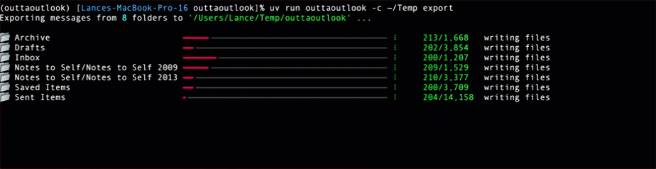

# OuttaOutlook

## Overview

OuttaOutlook is a Python command-line utility that gets your emails outta Microsoft Outlook and saves them locally in various file formats.



## Key Features

- Uses the [Microsoft Graph API](https://learn.microsoft.com/en-us/graph/use-the-api) to access Microsoft Outlook and Microsoft Exchange Server hosted mailboxes.
- Authenticates with Microsoft's device-code sign-in flow.
- Save messages as Markdown, HTML/TXT, JSON, raw EML, mbox archive, and Maildir directory formats.
- Download and save messages from selected folders or across the mailbox.
- Filter or search messages using Graph API query syntax.
- Download attachments, add tags and metadata.
- Skip emails previously downloaded.
- Cache Graph API responses for reuse, including optional offline operation with a primed cache.
- Multi-threaded for speed and improved performance.

## Installation & Setup

Use [uv](https://docs.astral.sh/uv/) to easily manage the Python environment and dependencies and run the utility.

```bash
uv python install 3.14
uv sync
uv run outtaoutlook --help
```

Create a `outtaoutlook_config.yaml` in the directory where you will run the commands or pass the path to a configuration file or directory explicitly:

```bash
uv run outtaoutlook --config-file config.yaml --help
```

## Commands

`outtaoutlook` has three commands: `auth` to manage authentication, `ls` to list mail folders and `export` to download and save messages and attachments.

```bash
uv run outtaoutlook --help

Usage: outtaoutlook [OPTIONS] COMMAND [ARGS]...

Gets your emails outta Microsoft Outlook and saves them locally in various file formats.

Options:
  --config-file, -c FILE     Read options from a config file or directory
  --auth-file FILE           Path to the authentication file
  --verbose, -v              Increase verbosity (repeat to increase level)
  --version                  Show the version and exit
  --help                     Show this message and exit

Cache options:
  --cache-dir DIRECTORY      Write cached files to this directory
  --cache-graph-api          Cache Graph API responses
  --no-cache-graph-api       Disable Graph API response caching
  --offline                  Make no network requests (requires a primed cache)

Commands:
  auth                       Sign in and grant access to Outlook
  export                     Export messages to local files
  ls                         List the mailbox folder tree
```

Each command's `--help` output shows full option names, value types, defaults, and descriptions.

```bash
uv run outtaoutlook auth --help
uv run outtaoutlook ls --help
uv run outtaoutlook export --help
```

### auth

Authenticate to Microsoft Outlook using the device-code sign-in flow. This command will prompt you to visit a URL and enter a device code to complete authentication. The authentication token is stored in a cache file for subsequent use by other commands.

```bash
# Sign in using the tenant and client IDs in the config file
uv run outtaoutlook --config-file config.yaml auth

# Or provide the IDs directly
uv run outtaoutlook auth --tenant YOUR-TENANT-ID --client YOUR-CLIENT-ID

# Show information about the cached authentication
uv run outtaoutlook auth --info

# Force sign-in again
uv run outtaoutlook auth --force
```

### ls

List the mailbox folders. You can display the folder tree up to a specified depth or list a particular folder path.

```bash
# List the mailbox folder tree; set the maximum displayed depth
uv run outtaoutlook ls --maxdepth 5

# List a particular folder path
uv run outtaoutlook ls "Inbox/Projects"
```

### export

Export messages from the mailbox to local files in various formats. You can specify folders, apply filters, download attachments, and add tags and metadata.

`export` requires `--outdir` and either one or more `--folder` options or `--mailbox` to download messages for all folders. `--folder` and `--mailbox` cannot be used together.

Available output formats are `eml`, `html`, `json`, `mbox`, `maildir`, and `md` (the default).

```bash
# Export one folder to Markdown
uv run outtaoutlook export --outdir ./mail --folder "Inbox" --format md

# Export the mailbox's top-level folders and their subfolders
uv run outtaoutlook export --outdir ./mail --mailbox --maxdepth 3

# Export one folder as EML, download attachments, and limit the number of messages
uv run outtaoutlook export --outdir ./mail-eml --folder "Inbox" --format eml --attachments --limit 250

# Apply repeated Graph filter criteria (use --search instead, not in combination)
uv run outtaoutlook export --outdir ./recent-mail --folder "Inbox" --filter "receivedDateTime ge 2026-01-01T00:00:00Z" \
  --tag "Recent"

# Test filter/search criteria without exporting messages
uv run outtaoutlook export --outdir ./mail --folder "Inbox" --filter "subject eq 'Project'" --filter-test
```

`--flat` writes messages in a single directory without preserving the folder hierarchy; `--shallow` preserves only the leaf folder name. These options cannot be combined.

Repeatable options such as `--folder`, `--not-folder`, `--filter`, `--search`, `--tag`, `--body-tag`, and `--metaprop` may be specified more than once.

## Authentication with the Microsoft Graph API

OuttaOutlook uses Microsoft's public-client device-code flow and requests the Microsoft Graph `Mail.Read` permission. It does not require a client secret.

1. Sign in to the [Microsoft Entra Admin Center](https://entra.microsoft.com/) (also accessible through the Azure portal) with an account allowed to register applications.
2. Open **Entra ID** → **App registrations**, select **New registration**, and provide an app name.
3. For an organization-specific application, select **Accounts in this organizational directory only**. Select **Register**.
4. Under **Manage** → **Authentication**, enable **Allow public client flows**. This is needed for the device-code flow. Do not create or distribute a client secret for this public-client CLI.
5. Open **Manage** → **API permissions** → **Add a permission** → **Microsoft Graph** → **Delegated permissions**, then add **Mail.Read**.
6. Grant consent as required by your organization. If user consent for `Mail.Read` is permitted, the signing-in user can consent during sign-in; otherwise, an administrator must select **Grant admin consent**. The account used by the CLI must be allowed to access the mailbox.
7. On the app's **Overview** page, copy:
   - **Directory (tenant) ID** — use for `--tenant`.
   - **Application (client) ID** — use for `--client`.

The first `auth` run displays Microsoft's device sign-in instructions; complete them in a browser to authorize the account. If access is granted, a token is stored locally for future runs.

```bash
uv run outtaoutlook auth --tenant YOUR-TENANT-ID --client YOUR-APPLICATION-CLIENT-ID
```

Alternatively, enter them under the `auth` section of the configuration file, or set and export `OUTTAOUTLOOK_TENANTID` and `OUTTAOUTLOOK_CLIENTID` environment variables.

## Configuration

A configuration file defined with YAML or JSON directives can be specified with the `--config-file`  (or `-c`) option. The option also accepts a directory; in that case, OuttaOutlook looks inside it for `outtaoutlook_config.yaml`. If not provided, OuttaOutlook looks for `outtaoutlook_config.yaml` in the current working directory.

The configuration file [`config.sample.yaml`](config.sample.yaml) provides an example configuration.

Option precedence and behavior:

- Values in the configuration file provide defaults for command options. An explicitly supplied CLI option takes precedence over its configured default.
- The `folder`, `not_folder`, `tag`, `body_tag`, `metaprop`, `filter`, and `search` option values defined in the configuration file are combined with command line values. Meta properties supplied on the command line override configuration file properties with the same name.
- `--offline` requires Graph API caching to be enabled and a cache that has already been populated.

## License

This project is distributed under the BSD 3-Clause License. See [LICENSE](LICENSE) for the full text.
